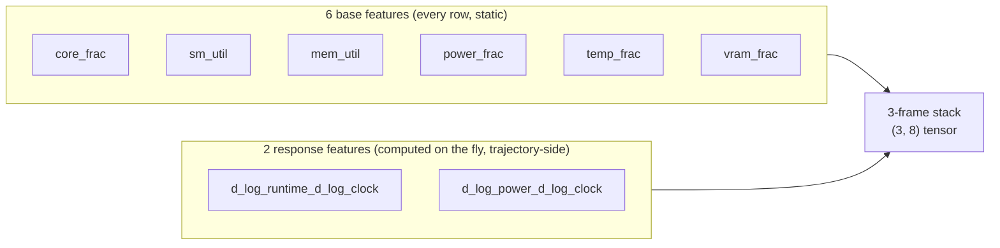
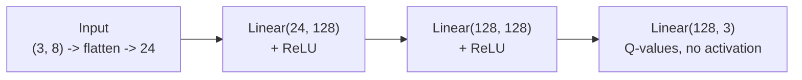
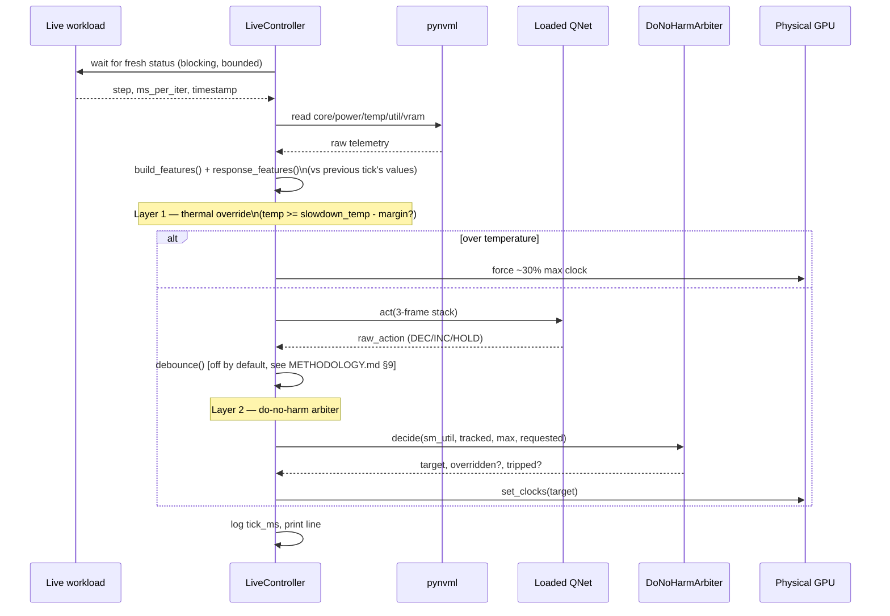
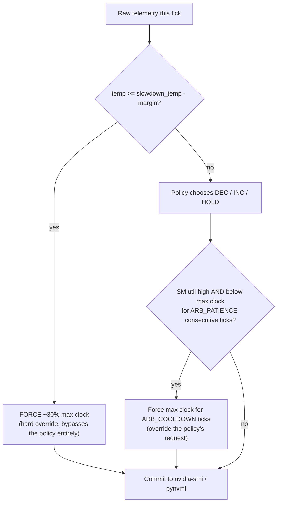

# ARCHITECTURE.md — System and Software Design

> Companion to [METHODOLOGY.md](METHODOLOGY.md) (what was done and why) and
> [RESULTS.md](RESULTS.md) (what it measured). This document describes
> **what the system is built from** — the live, unified `common/` design.
> For the superseded per-card trees (`gpus/rtx4500_ada/`,
> `gpus/rtx3050ti_laptop/`), see [CLAUDE.md](CLAUDE.md) §1–§11; they are kept
> for the RTX 4500 contrast case only and are not part of this document.

---

## 1. High-level system architecture

The system has two phases that never run at the same time: an **offline
phase** that produces a trained policy, and an **online phase** that deploys
it against a live GPU. Both phases share one source of truth for state
representation: `common/features.py`.

```mermaid
flowchart TB
    subgraph OFFLINE["OFFLINE — per GPU, once"]
        direction TB
        BENCH["12 PyTorch/CUDA benchmarks\n(common/benchmarks/*.py)"]
        PROBE["gpu_probe.py\ncapability probe: confirms clock-lock\nactually applies (readback-verified)"]
        COLLECT["collect_dataset.py\n2D core x memory sweep\nwindow-scoped NVML sampling"]
        RAW["raw CSV\n(gpus/<slug>/data/*.csv)"]
        PREP["preprocess_desktop.py\n6-feature extraction,\n(GPU,driver) pin"]
        DSV["dataset_view.py\ncore-only reachable view,\nrenormalised reward"]
        ENV["unified_env.py\nmulti-GPU Gymnasium env"]
        TRAIN["train_unified_v2.py\nDDQN training loop"]
        WEIGHTS["trained weights\n(common/weights/*.pth)"]

        PROBE --> COLLECT
        BENCH --> COLLECT
        COLLECT --> RAW --> PREP --> DSV --> ENV --> TRAIN --> WEIGHTS
    end

    subgraph ONLINE["ONLINE — live deployment, continuous"]
        direction TB
        WORKLOAD["live workload\n(e.g. live_resnet50_train.py)\nwrites throughput status file"]
        NVML["NVML telemetry read\n(pynvml, in-process)"]
        FEAT["build_features() + response_features()\nsame 8-dim state as training"]
        POLICY["loaded QNet\n(weights from OFFLINE phase)"]
        L1["Layer 1: thermal override\n(hard, always on)"]
        L2["Layer 2: do-no-harm arbiter\n(DoNoHarmArbiter)"]
        ACT["nvidia-smi / pynvml\nclock lock"]

        WORKLOAD --> NVML --> FEAT --> POLICY --> L2
        FEAT -.temp.-> L1
        L1 --> ACT
        L2 --> ACT
    end

    WEIGHTS -.loaded by deploy_live.py.-> POLICY
```

**Why two phases, not one continuous loop.** The RL environment is a static
table of profiled operating points, not a live GPU and not a dynamics model
(§3). Training needs millions of cheap, repeatable steps against that table;
deployment needs one real, careful step every tick against hardware that
costs money and can overheat. Separating them lets training be fast,
parallel, and offline, while deployment stays simple, safety-layered, and
auditable.

---

## 2. Module map

| File | Owns | Notes |
|---|---|---|
| `common/features.py` | The 6 base features + 2 response features, action set, stack size, raw CSV schema | **Single source of truth.** Every other file imports from here; nothing redefines a feature locally. |
| `common/gpu_probe.py` | Capability detection + hardware limits (`hardware_limits()`) | Run first on every machine, before profiling or deploying. Readback-verifies every clock/power claim rather than trusting the command's exit text. |
| `common/collect_dataset.py` | 2D core×memory profiler | Telemetry is window-scoped (`Window: <start> <end>` markers + `get_stats(window)`) — the fix for the telemetry-dilution bug (§5 of METHODOLOGY.md). |
| `common/preprocess_desktop.py` | Raw CSV → 6-feature `preprocessed_dataset.csv` | Pins each dataset to the exact (GPU, driver) pair that produced it; catches silent driver/hardware-limit drift. |
| `common/dataset_view.py` | Core-only reachable view with correctly renormalised reward | `core_only_view()` also computes `RewardTrain` (log-scale), a strict opt-in alongside the unchanged linear `Reward`. |
| `common/unified_env.py` | Multi-GPU Gymnasium env | `discover_datasets()` globs `gpus/*/data/preprocessed_dataset.csv`; `--holdout` support for leave-one-GPU-out. |
| `common/train_unified_v2.py` | Configurable DDQN trainer | `QNet`, `Cfg`, `train()`, `GreedyAgent`. Every reward-shaping/action-shaping knob this project tried lives in `Cfg` (§7). |
| `common/eval_policies.py` | Policy-agnostic evaluation + full baseline suite | `rollout()`, `evaluate_policy()`, and every baseline policy (`p_governor`, `p_fixed`, `p_hillclimb`, `p_agent`, …). |
| `common/deploy_live.py` | Live deployment daemon | `LiveController`: NVML read → feature build → policy → Layer 2 arbiter → clock write, every 200ms. Optional cycle lock-in (`--lockin-k`): detects a short clock cycle, probes each visited level, parks at the best-EDP one, releases on EDP degradation or work shift. See `oscillation_update.md`. |
| `gpus/rtx3050ti_laptop/deployment/arbiter.py` | `DoNoHarmArbiter` | Imported unmodified by `deploy_live.py` — not reimplemented per deployment target. |
| `common/analysis/*.py` | Every experiment and sweep that produced a reported number | One script per experiment; each is a standalone, re-runnable record (§4 of METHODOLOGY.md explains why this convention exists). |

---

## 3. State, action, and reward — the contract every component shares

### 3.1 State (`common/features.py`)



- **Base 6**: every value is normalised against *that card's own* NVML
  limits (`gpu_probe.hardware_limits()`), so `0.7` means the same physical
  thing on a 70W laptop chip and a 450W desktop card. Deliberately excluded:
  a workload one-hot (cannot exist for an unseen app — this is what makes
  "one model" possible at all) and `Avg_Time_S` (not observable live).
- **Response 2**: elasticities measured between the row *before* an action
  and the row *after* it — `response_features(prev_core, cur_core,
  prev_time, cur_time, prev_power, cur_power)`. Clipped to ±`RESPONSE_CLIP`
  and mapped to `[0,1]`. Computed identically by the offline evaluator
  (`eval_policies.augmented_obs`), the training loop
  (`train_unified_v2.py`'s fast inner loop), and the live deployment daemon
  (`deploy_live.py`'s `tick()`) — one function, three call sites, so training
  and deployment can never silently diverge.
- **Frame stack**: 3 — `(3, 8)` input to the network, flattened to 24.

### 3.2 Action (relative, 3-way)

```
0 = DEC_CORE   tracked_setpoint -= stride
1 = INC_CORE   tracked_setpoint += stride
2 = HOLD       tracked_setpoint unchanged
```

`stride` is inferred per-workload from the profiled grid's own level
spacing in simulation (`infer_stride`), and approximated by
`CORE_STRIDE_FRAC * max_core_mhz` in live deployment (no profiled grid to
infer from at runtime).

### 3.3 Reward

```
sedp(row)      = 1 − per-workload-minmax(EDP)        [linear, the metric
                                                        every reported
                                                        number means]
sedp_train(row)= 1 − per-workload-minmax(log(EDP))    [log-scale, TRAINING
                                                        ONLY, strict opt-in
                                                        via Cfg.use_log_reward]
r(s,a)         = sedp_train(s') if Cfg.use_log_reward else sedp(s')
                 − action_cost · 1[a ≠ HOLD]
                 − reversal_cost · 1[a reverses the last non-HOLD move]
```

`EDP = Avg_Pwr_W · Avg_Time_S²`, computed once offline per profiled row.
`dataset_view.core_only_view()` renormalises the min-max over only the rows
a core-only controller can actually reach (§2 of METHODOLOGY.md explains
why this matters). Evaluation always scores the unchanged linear `sedp`
regardless of what a policy was trained on, so numbers stay comparable
across every experiment in this repo.

---

## 4. Network architecture



```python
class QNet(nn.Module):
    def __init__(self, in_dim, n_actions, hidden=128, dueling=False):
        self.trunk = Sequential(Flatten(), Linear(in_dim, hidden), ReLU(),
                                 Linear(hidden, hidden), ReLU())
        self.out = Linear(hidden, n_actions)   # dueling head available, settled OFF
```

~25.6K parameters (base-6 ablation) or ~27K (response-aware, `in_dim=24`
vs `18`). Settled via a 15-configuration sweep (`sweep_rl.py --preset
screen`) — see METHODOLOGY.md §6 for the full table and why each
alternative lost.

---

## 5. Training-time data flow (one episode)

```mermaid
sequenceDiagram
    participant Env as build_pool() / prepare()
    participant Loop as train() inner loop
    participant Net as QNet (policy)
    participant Buf as Replay buffer

    Loop->>Env: pick random (gpu, workload) pair from pool
    Loop->>Env: pick random start row
    Env-->>Loop: initial augmented_obs, repeated x3 (frame stack)
    loop 50 steps
        Loop->>Net: argmax Q(stack) [eps-greedy]
        Net-->>Loop: action
        Loop->>Loop: move tracked core_frac, snap to nearest profiled row
        Loop->>Env: augmented_obs(new row, prev row)
        Env-->>Loop: response-augmented observation
        Loop->>Buf: push (stack, action, reward, next_stack, done=0)
        Loop->>Net: sample batch, Huber loss, grad-clip, Adam step
    end
    Loop->>Net: hard-copy to target net every 5 episodes
```

`done` is **always 0** — this environment never terminates; `truncated`
fires at `max_steps` but that boundary doesn't exist in deployment, so the
bootstrap stays alive through it (one of three RL bugs fixed in `v2`, see
METHODOLOGY.md §6).

---

## 6. Deployment-time data flow (one tick, `LiveController.tick()`)



**Measured real-hardware tick latency** (NVML read through clock write,
excluding the bounded wait for fresh workload status): mean 6.46ms, std
2.47ms, range 3.6–13.4ms over 40 ticks on a rented RTX 4090 — see
RESULTS.md §8.

---

## 7. Safety design — two independent layers



- **Layer 1 (thermal)**: unconditional, cannot be overridden by the policy.
  Checked before the policy even runs.
- **Layer 2 (do-no-harm arbiter, `DoNoHarmArbiter`)**: watches SM
  utilisation directly rather than reconstructing EDP by dataset lookup
  (the 6-feature design deliberately excludes the workload-identifying
  features that lookup would need — see METHODOLOGY.md §2). Redesigned,
  not ported, from the deleted RTX 4500-era arbiter for exactly this reason.
- Both layers are **exercised on real hardware**, not just unit-tested: on
  a compute-bound run the arbiter fired on 61.9% of ticks and was the
  primary reason the net result stayed a win instead of a regression; on a
  launch-bound run it never fired at all because the policy didn't need it.
  Clocks reset cleanly on every exit path tested (normal exit, `SIGINT`,
  `SIGKILL`) across every rented session this project has run.

---

## 8. Repository layout (live tree only)

```
common/
  features.py              state/action schema -- source of truth
  gpu_probe.py              capability probe
  collect_dataset.py        2D core x mem profiler (window-scoped)
  preprocess_desktop.py     raw CSV -> 6-feature view
  dataset_view.py           core-only view, renormalised + log reward
  unified_env.py            multi-GPU Gymnasium env
  train_unified_v2.py       configurable DDQN trainer (3 bug fixes + every shaping knob)
  eval_policies.py          evaluation + full baseline suite
  deploy_live.py            live deployment daemon (two safety layers)
  benchmarks/               12 PyTorch/CUDA workloads (profiling) + live_resnet50_train.py (deployment)
  weights/                  every trained checkpoint, named by holdout GPU (+ seed, + config tag)
  analysis/                 one script per experiment -- the paper's entire evidence trail
  reversal_cost_repeat_trials.sh, reversal_cost_low_repeat_trials.sh,
  reversal_cost_010_multiseed_trials.sh
                            hardware-confirmation orchestration (bash, run on the rented box)

gpus/
  rtx3050ti_laptop/         physical laptop card; data/preprocessed_dataset.csv
                            already matches common/features.py's schema (verified
                            directly, 8 Oct 2026) -- NOT a second architecture, just
                            a second physical form factor on the same code
  rtx4500_ada/               OUT OF SCOPE — professional workstation card, kept only
                            as a supplementary memory-clock-control contrast case,
                            still on the old 28-feature one-hot design (CLAUDE.md §1-11)

docs/
  results/                  every CSV a reported number came from, committed raw
  results/*_phase2_hardware/ raw hardware logs (git-ignored pattern force-added,
                            see METHODOLOGY.md §10 for why)
  charts/                   generate_charts.py + its PNG outputs, used by RESULTS.md

context.md, NORTHSTAR.md, CLAUDE.md
                            session handoff, scorecard, deep technical reference
                            (superseded-architecture sections marked as such)
```

---

## 9. Why this shape, not the alternatives

Each of the following is a real design fork this project hit and resolved.
Full reasoning (what was tried, what broke, what the data said) lives in
[METHODOLOGY.md](METHODOLOGY.md); this section is the one-line map of
**where** each decision shows up in the architecture above.

| Fork | Chosen | Shows up as |
|---|---|---|
| One model vs. per-GPU weight library | One model | §3.1's device-normalised 6 features — the only thing that makes a single weights file meaningful across a 70W and a 450W card |
| Snapshot state vs. response-augmented state | Response-augmented | §3.1's 2 response features, computed identically in 3 places (training, eval, deployment) |
| Live GPU env vs. table-backed simulator | Table-backed simulator | §1's OFFLINE phase being pure CPU/data work, no GPU needed to train |
| Linear vs. log-scale training reward | Both, log is opt-in | §3.3 — `Cfg.use_log_reward` / `reward_power`, never silently replacing the evaluation metric |
| One safety layer vs. two independent ones | Two | §7 — thermal (unconditional) and arbiter (utilisation-based), neither able to be bypassed by the other failing |
| Ported old arbiter vs. redesigned | Redesigned | §7 — the old version needed workload-identifying features the state design deliberately excludes |
