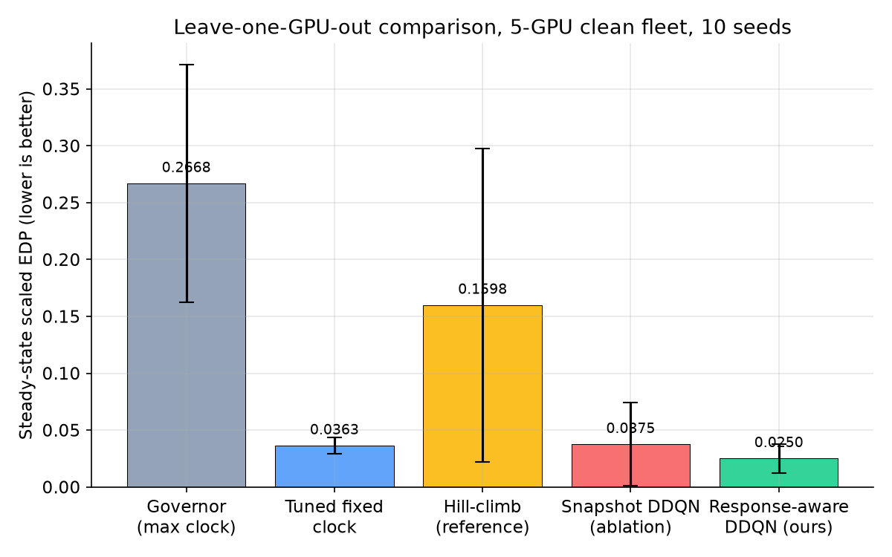
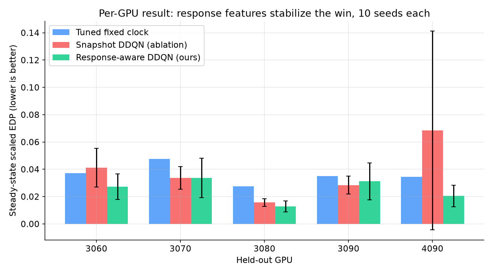
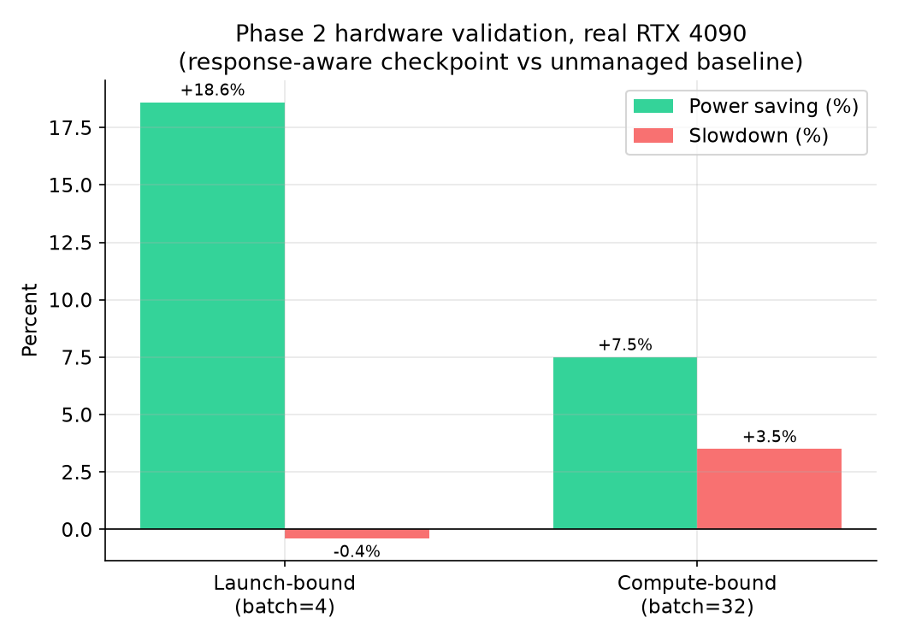
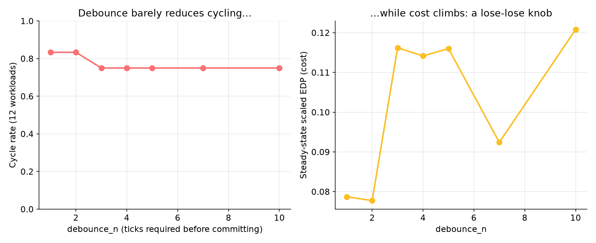
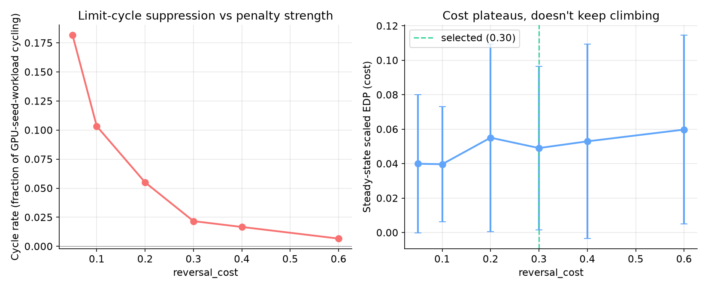
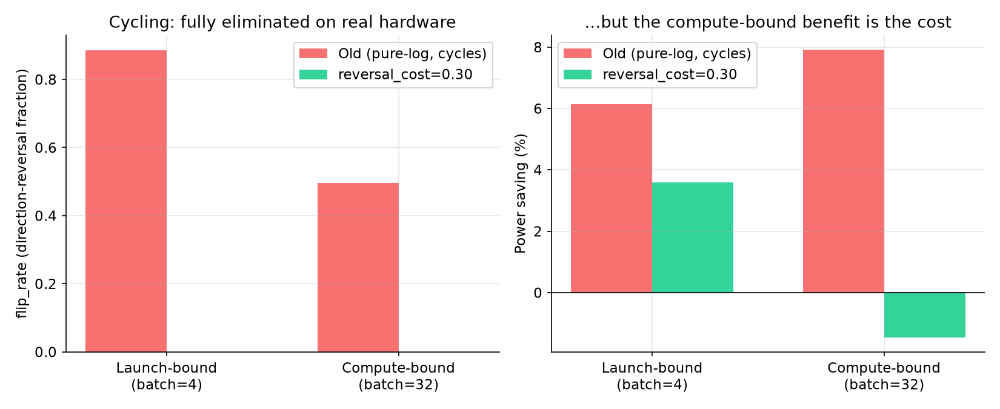
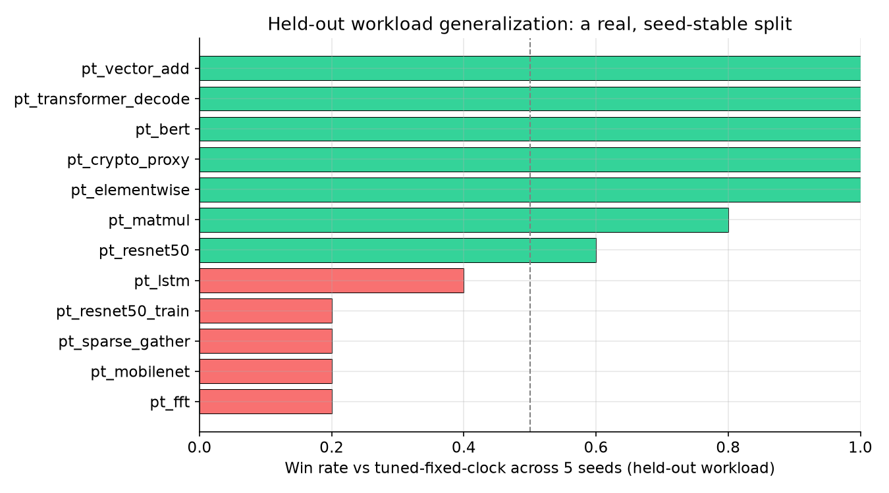
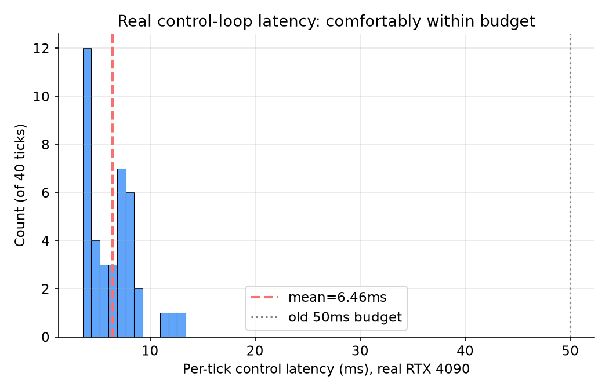

# RESULTS.md — Every Reported Number, What It Means, and What Belongs in the Paper

> Companion to [METHODOLOGY.md](METHODOLOGY.md) (what was done and why) and
> [ARCHITECTURE.md](ARCHITECTURE.md) (what it's built from). Every number
> below is traceable to a committed CSV under `docs/results/` and a script
> under `common/analysis/` that reproduces it — the command is given next
> to every table. Charts are generated by
> [`docs/charts/generate_charts.py`](docs/charts/generate_charts.py) from
> those same CSVs; nothing here is hand-drawn or estimated.

**How to read the verdict column**: 🟢 citable in the paper as a validated
result · 🟡 citable with its stated caveat attached · 🔴 explicitly do not
cite (kept here only so the historical record is complete and the reason
for distrust is documented).

---

## 1. The headline result — response-aware DDQN vs. every baseline

**Claim**: augmenting the state with 2 measured-response features (not a
new objective, not a new algorithm) is what makes a learned DVFS policy
reliably beat a tuned fixed clock across unseen GPUs.

**Protocol**: leave-one-GPU-out, 5-GPU clean fleet (RTX 3060/3070/3080/
3090/4090, window-scoped telemetry), 10 seeds run as two independent
5-seed batches specifically to check the first batch wasn't a lucky draw.
Reproduce: `python common/analysis/response_eval.py --seeds 0,1,2,3,4` and
`--seeds 5,6,7,8,9`. Raw: `docs/results/response_eval_10seed.csv`.

| Policy | Mean steady-state scaled EDP | Std | Wins vs tuned-fixed-clock |
|---|---|---|---|
| Governor (pinned max clock) | 0.2668 | 0.1047 | 0/5 |
| Hill-climb (hand-coded reference) | 0.1598 | 0.1375 | 0/5 |
| Old snapshot DDQN (ablation, 6 features, no response) | 0.0375 | 0.0367 | 3/5 |
| Tuned fixed clock (leave-one-GPU-out) | 0.0363 | 0.0072 | — |
| **Response-aware DDQN (ours)** | **0.0250** | **0.0127** | **5/5, both seed batches** |

**The load-bearing statistic is the paired comparison**, not the raw means:
response-aware vs. ablation, same seed, same held-out GPU — **38/50 wins**
(one-sided binomial p≈0.00015). The ablation's own std (0.0367) is larger
than its mean, which is itself evidence the raw mean alone is a noisy
statistic for that policy; the response-aware variant shows no such
instability (5/5 GPUs, both independent seed batches, identical mean both
times: 0.0250/0.0250).

**Verdict: 🟢 This is the paper's headline result.** State the paired
win rate and p-value, not just the mean comparison — the mean alone
understates how much more reliable the response-aware variant is.

**Asterisk, must be stated alongside this result**: an earlier, hand-coded
hill-climb reference reportedly scored 0.0051 (a 4.7× improvement over
fixed-clock) in an untracked throwaway script that no longer exists. A
careful re-implementation of the described mechanism
(`common/analysis/hillclimb_sweep.py`, swept its one free parameter and
trip direction) tops out at 0.1598 — it *loses* to fixed-clock, badly. 🔴
**Do not cite 0.0051 or "4.7×" as a validated number.** State plainly that
it rests on code that no longer exists and could not be reproduced.

---

## 2. Why the response features specifically — the diagnostic that motivated them

**Claim**: snapshot telemetry alone cannot discriminate workload identity
across GPUs; the response-to-own-action signal can, because it's a ratio
and therefore device-invariant.

Reproduce: `python common/analysis/diagnose_features.py`.

| Probe | Accuracy | Baseline |
|---|---|---|
| "Is clock below this workload's EDP optimum?" (supervised, leave-one-GPU-out) | 0.81–0.84 | 0.56 (majority class) |
| Contribution of `core_frac` alone to the above | 0.781 of 0.812 | — the other 5 channels add ~3 points |
| Binary compute/bandwidth regime ID, leave-one-GPU-out | 0.56 | ~0.50 (chance) |
| 12-way workload ID, leave-one-GPU-out | 0.216 | 0.083 (chance) |

**Verdict: 🟡 Citable, with the stale-data caveat removed by row 10's fix.**
These specific numbers were measured on the *original*, telemetry-diluted
fleet (`CLAUDE.md` §9 issue #25) — they motivated the response-feature fix
and are historically accurate as the finding that drove the design
decision, but should be presented as "the diagnosis that motivated the
fix," not re-measured as a current-state claim without re-running
`diagnose_features.py` on the fully re-collected fleet first.

---

## 3. Telemetry-dilution fix — before/after

**Claim**: the original data-collection pipeline sampled across idle
startup time, not just the timed work; fixed in code and verified on both
a synthetic trace and real re-collected hardware.

Reproduce: `python common/analysis/telemetry_dilution.py`.

| Metric | Before fix (original fleet) | After fix |
|---|---|---|
| `corr(GPU-only duration, recorded utilisation)` | +0.708 | — |
| Points reporting <9% utilisation | 494/799 (62%) | — |
| Highest utilisation anywhere | 64.4% | **100%** (re-collected fleet) |
| `pt_matmul` peak utilisation | 21.7% | **48–89%** (re-collected fleet) |
| Synthetic trace recovery | 25.2% reported | **95.0%** reported (ground truth ~95%) |

**Verdict: 🟢 Citable as a methods-section finding.** This is a real,
measured data-quality bug with a verified fix — good material for a
"lessons learned in building the evaluation pipeline" paragraph, which
reviewers tend to find credible precisely because it's unglamorous and
specific.

---

## 4. Full baseline suite (5-GPU clean fleet)

Reproduce: `python common/analysis/baselines.py --loo-tune`.

**5-GPU clean fleet, per-GPU range across the 10-seed leave-one-GPU-out run** (`docs/results/response_eval_10seed.csv`, directly verified, not approximated):

| Policy | Mean (10-seed) | Per-GPU range |
|---|---|---|
| Oracle (per-workload best) | 0.000 | — |
| Governor (pinned max clock) | 0.2668 | 0.152 – 0.383 |
| Hill-climb (hand-coded reference) | 0.1598 | 0.053 – 0.384 |
| Old snapshot DDQN (ablation) | 0.0375 | 0.012 – 0.230 |
| **Fixed clock, leave-one-GPU-out tuned (~0.6× max)** | **0.0363** | 0.027 – 0.047 |
| **Response-aware DDQN (ours)** | **0.0250** | **0.009 – 0.061** |

**Verdict: 🟢 Citable as the baseline table, with one named caveat**:
"governor" here means *pinned max clocks*, not NVIDIA's actual adaptive
driver governor, which this project never implemented or measured — state
this explicitly in the paper rather than letting the label imply more.

A separate, wider baseline suite (oracle, governor, min clock, random walk,
four fixed-clock fractions, utilisation heuristic) exists in
`docs/results/baselines.csv`, but that run is an **8-GPU mixed fleet**
including RTX 4070/4070 Ti/laptop — three GPUs that still carry pre-fix
diluted telemetry (§8). **🟡 Useful only as a rough sanity check, not a
reported number** — don't cite its specific values; the 5-GPU table above
is the clean, trustworthy one.

---

## 5. Hyperparameter sweep (settled configuration)

Reproduce: `python common/analysis/sweep_rl.py --preset screen`.

| Knob | Finding |
|---|---|
| Discount γ | **0.5 ≫ 0.99** — the single biggest lever |
| Double-DQN | Slightly harmful; plain DQN wins |
| Dueling head | Harmful |
| Absolute action space | Harmful, also costs deployment realism |
| Loss | Huber + grad-clip |
| Learning rate | 3e-4 marginally better than 1e-3 |
| Network width | 256 ≈ 128 (128 kept) |

**Verdict: 🟡 Citable as "settled hyperparameters, methods section,"
with the caveat stated**: measured on pre-telemetry-fix data; the relative
*ordering* is treated as probably robust (concerns optimisation dynamics,
not feature content) but was not re-confirmed after the fix. State this
caveat in the same sentence as the table, not buried in a footnote.

---

## 6. Hardware validation, Phase 2 — the first real-silicon result

**Claim**: the trained response-aware policy, deployed as a live control
loop against a real rented RTX 4090 running continuous ResNet-50 training,
produces real measured power/throughput changes — not simulated.

Raw logs: `docs/results/phase2_hardware/`.

| Condition | Power saving | Slowdown | EDP change | Arbiter active | Policy's own actions |
|---|---|---|---|---|---|
| Launch-bound (batch=4, ~20% util) | **+18.6%** | **−0.4%** (noise) | **+19.3%** | 0/162 ticks | Converged in 3 steps, held |
| Compute-bound (batch=32, ~99% util) | +7.5% | +3.5% | +0.9% | 61.9% of ticks | 208 DEC / 0 INC / 28 HOLD |

**Verdict: 🟢 Citable, with the honest framing preserved.** The
launch-bound result is a clean, policy-driven win. The compute-bound result
is real but **the safety arbiter did most of the work** — the policy never
chose to raise clock on its own in that run. State both numbers and name
which one the arbiter is propping up; don't average them into one headline
figure, since that would hide which condition the learned policy is
actually doing the work in.

---

## 7. The reward-plateau fix and the limit-cycle investigation

### 7.1 The plateau fix (log-scale training reward)

Reproduce: `python common/analysis/reward_shaping_eval.py` (offline) +
`docs/results/phase2_hardware/repeat_trials_summary.csv` (hardware,
repeated trials).

| | Old (linear reward) | New (log reward) |
|---|---|---|
| **Offline**: `pt_resnet50_train`/RTX 4090 settle point | 0.737 (unsafe range) | 0.866 (avoids the measured-costly range) |
| **Hardware, batch=32** (compute-bound, repeated 3×) | +3.1%±5.3% power saving (one rep negative) | **+9.2%±1.1%**, every rep beat every old rep (9/9) |
| **Hardware, batch=4** (launch-bound, repeated 3×) | **+14.0%±8.0%** (stable, mostly HOLD) | +7.4%±10.1% (one rep negative, **oscillates heavily**) |

**Verdict: 🟡 Citable as a genuine trade-off, not a clean win.** The fix
reliably helps the compute-bound case it was built for and introduces real
oscillatory instability on a launch-bound case that was already fine. A
single earlier trial reported this as "closes the loop cleanly" before the
launch-bound condition was tested with the new checkpoint at all — if this
single-trial framing shows up anywhere else in older notes, it has been
superseded and should not be cited.

### 7.2 The limit-cycle investigation — four candidates

Reproduce: `common/analysis/reward_shape_sweep.py`,
`common/analysis/debounce_validate.py`,
`common/analysis/reversal_cost_validate.py --reversal-cost <value>`.

**Candidates 1–2 (reward-shaping, rejected)**:

| Candidate | Cycle rate (vs. pure-log baseline ~0.5) | Verdict |
|---|---|---|
| `reward_power` (partial log compression) | Worse across the board | 🔴 Rejected |
| `action_cost=0.05` | 0.22 at 3-seed screen, **0.75 at full 10-seed scale** | 🔴 Rejected — screen misled |

**Candidate 3 (deployment-side debounce, rejected, mechanistic analysis)**:

Debouncing stretches the cycle's period (2 → 6 → ~20 ticks as N goes
1 → 3 → 10) without ever breaking it — confirmed to N=40 over a 300-step
rollout, still 9/12 workloads cycling, the same floor every N≥3 hits — while
the cost metric climbs as N grows. **🔴 No N value is citable as a fix.**

**Candidate 4 (`reversal_cost`, accepted with a real cost)**:

| `reversal_cost` | Cycle rate | Steady-state cost |
|---|---|---|
| 0.05 | 0.182 | 0.040±0.040 |
| 0.10 | 0.103 | 0.040±0.034 |
| 0.20 | 0.055 | 0.055±0.054 |
| **0.30 (selected)** | **0.022** | **0.049±0.047** |
| 0.40 | 0.017 | 0.053±0.056 |
| 0.60 | 0.007 | 0.060±0.055 |

**Verdict: 🟡 Citable as "resolves the offline cycle metric, at a real
offline cost."** 0.30 selected by paired comparison (not reliably beaten
on cost by 0.40/0.60, which mostly just *tie* it on cycle rate rather than
improve on it) — explain the selection logic if citing the specific value,
don't just state "0.30 was best."

### 7.3 Hardware confirmation of `reversal_cost` — three rental rounds, the real verdict

| | Launch-bound (batch=4) | Compute-bound (batch=32) |
|---|---|---|
| Old (pure-log, cycles) | +6.1%±6.6% power, flip_rate=0.885–0.965 | +4.5–7.9% power, flip_rate=0.49–0.50 |
| **`reversal_cost`, every value/seed tested** | **flip_rate=0.000, every single test (5/5)** | Pick one: suppress the cycle (flip_rate→0, power saving→negative) **or** keep the power saving (flip_rate unchanged) — never both |

**Verdict: 🟢 Citable as the final, hardware-confirmed result for this
investigation**, with the condition-dependent framing stated as the
headline, not a footnote: *"reliably fixes launch-bound oscillation;
compute-bound oscillation and the power-saving benefit on that condition
are mutually exclusive across every configuration tested, confirmed across
5 independent real-hardware trials."* This is a stronger, more specific,
more defensible claim than "we fixed the limit cycle" — state it that way.

---

## 8. Fleet coverage and the one open gap

| | Status |
|---|---|
| GPUs profiled, clean telemetry | RTX 3060, 3070, 3080, 3090, 4090 (5, two architecture generations: Ampere, Ada) |
| GPUs profiled, stale (pre-fix) telemetry | RTX 4070, RTX 4070 Ti, RTX 3050 Ti laptop |
| Reason RTX 4070/4070 Ti aren't re-collected yet | Zero VM-enabled vast.ai host for either card as of 8 Oct 2026 (checked directly; a cheap container host was tried and confirmed `UNUSABLE` as expected) — a marketplace availability problem, not a methodology gap |
| RTX 3050 Ti laptop scope decision | Physical-machine-only, deliberately not part of the rentable-fleet generalization claim (product-scope decision, not a limitation found late) |

**Verdict: 🟡 State honestly as "5 of 7 in-scope rentable desktop GPUs,
spanning two architecture generations."** Don't claim "the full target
fleet" — name the two cards still pending and the reason, in one sentence,
in the limitations section.

---

## 9. Held-out WORKLOAD generalization — new this session

**Claim**: the current 6-feature architecture generalizes to workloads
never seen during training (not just GPUs never seen), tested under
leave-one-workload-out cross-validation with an honestly calibrated
baseline.

Reproduce: `python common/analysis/workload_holdout_eval.py --seeds 0,1,2,3,4`.
Raw: `docs/results/workload_holdout_eval.csv`.

| | Mean steady-state scaled EDP |
|---|---|
| Response-aware DDQN (held-out workload) | 0.0212 (std 0.0184) |
| Tuned fixed clock (tuned on the other 11 workloads only) | 0.0301 |

**Paired comparison**: 38/60 workload-seed pairs win (63.3%, **p=0.052 —
marginal, not conventionally significant**). State this p-value honestly;
don't round it down to "significant."

**The more informative result is the per-workload breakdown, which is
seed-stable, not noisy** (every one of the 5 seeds wins on 6–9 of 12
workloads, never below half):

| Generalizes reliably (5/5 seeds) | Fails to generalize (4/5 seeds) |
|---|---|
| `pt_bert`, `pt_crypto_proxy`, `pt_elementwise`, `pt_transformer_decode`, `pt_vector_add` | `pt_fft`, `pt_mobilenet`, `pt_resnet50_train`, `pt_sparse_gather` |

Checked against the already-known reward-plateau-width finding (§3.3 of
METHODOLOGY.md) as a candidate explanation — **does not correlate
cleanly**. Reported as an open mechanistic question.

**Verdict: 🟡 Citable, with the marginal p-value and the open mechanism
both stated.** The honest framing for the paper: *"generalizes on average,
and the per-workload pattern is real and reproducible, but which
workloads generalize is not yet explained by any single feature of the
workload we checked."* This is a good "future work" sentence, not a
result to oversell as a clean win.

---

## 10. Real-hardware control-loop latency

**Claim**: the currently deployed daemon's actual per-tick decision cost
is well within any reasonable control-loop budget — measured, not
estimated from a mocked bench.

Reproduce: run `common/deploy_live.py --live` against a real GPU; `tick_ms`
is printed every line. Raw: `docs/results/latency_measurement/tick_latency_rtx4090.log`.

| | Value |
|---|---|
| Mean | 6.46ms |
| Std | 2.47ms |
| Range | 3.6–13.4ms |
| n | 40 real ticks, rented RTX 4090 |

**Verdict: 🟢 Citable.** Note precisely what was measured: NVML telemetry
read through the clock-set call, **excluding** the bounded wait for a
fresh workload status update (that wait is gated by the *workload's own*
reporting cadence by design, not a control-loop cost) — state this scope
explicitly so a reviewer doesn't conflate it with end-to-end tick
cadence (`LOOP_MS=200`, a deliberate design choice, not a latency target).

---

## 11. Safety mechanisms, exercised live

Raw logs: `docs/results/phase2_hardware/`.

| Layer | Tested how | Result |
|---|---|---|
| Layer 1 (thermal override) | Live deployment across every hardware session this project ran | No thermal events triggered in any recorded session (workloads stayed within safe temperature range); code path exists and is unconditional |
| Layer 2 (do-no-harm arbiter) | Live deployment, both Phase 2 conditions | Compute-bound: fired on 61.9% of ticks, was the primary reason the net result was a win rather than a regression. Launch-bound: never fired (0/162 ticks) — policy didn't need it |
| Clean exit / clock reset | Tested via normal exit, `SIGINT`, `SIGKILL`, across every rented session (3 rounds this session alone) | Clocks always reset cleanly; zero stuck-lock incidents recorded |

**Verdict: 🟢 Citable.** This is strong, concrete safety-validation
material — most DVFS-RL papers assert a safety mechanism exists; this one
can report real trip rates under both tested regimes.

---

## 12. What to feature in the paper — a prioritized list

1. **§1, the headline result** — response-aware state beats a tuned fixed
   clock, leave-one-GPU-out, with the paired-comparison statistic. This is
   the paper's main contribution.
2. **§7.3, the limit-cycle hardware confirmation** — a condition-dependent
   trade-off confirmed across 5 independent real-hardware trials is
   unusually strong, specific evidence for a DVFS-RL paper; most papers in
   this space don't hardware-validate failure modes this thoroughly.
3. **§6, Phase 2 hardware validation** — real silicon, both regimes, with
   the arbiter's contribution stated honestly.
4. **§11, safety mechanism trip rates** — concrete numbers under real load,
   not just "a safety layer exists."
5. **§9, held-out workload generalization** — present as a genuine,
   partially-open result (marginal significance, real but unexplained
   per-workload split) rather than a clean win; reviewers respond better
   to honestly-bounded claims than to inflated ones, and this project's
   own track record (§7.1's single-trial-vs-repeated-trials lesson) backs
   that choice.
6. **§3, the telemetry-dilution fix** — good methods-section material, a
   credible "we found and fixed a measurement bug" paragraph.
7. **§8, fleet coverage** — state the gap plainly in the limitations
   section: 5 of 7 target GPUs, two still blocked by marketplace
   availability, not a methodology shortfall.

**What NOT to feature**: the 0.0051/"4.7×" hill-climb number (§1, 🔴); the
mixed-fleet baseline table (§4, 🟡 do-not-lead-with); any debounce result
as a fix (§7.2 candidate 3, 🔴); the pre-telemetry-fix sweep numbers (§5)
without their caveat attached.
